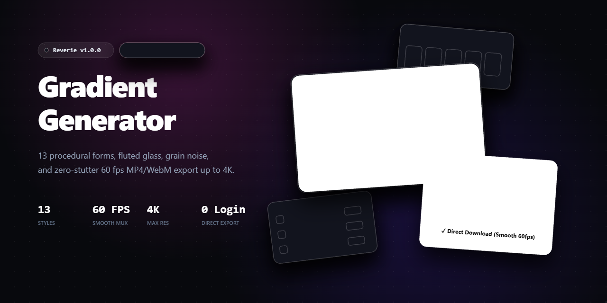

# SaaS Procedural Gradients — Universal AI Agent Skill



[](SKILL.md)
[](LICENSE)
[](AGENTS.md)
[](references/remotion-canvas.md)

A universal, zero-dependency procedural gradient generator, optical shader engine, and AI agent skill for **Remotion**, **HyperFrames**, and **HTML5 Canvas**. 

Designed for AI coding agents (**Antigravity**, **Claude Code**, **Cursor**, **Windsurf**, **Codex**, **Devin**) to eliminate generic, muddy CSS linear gradients and generate high-end, mathematically continuous 60 FPS chromatic strata, luxury fluted glass refraction, and cryptographic film grain.

---

## 🤖 Install as an Agent Skill

### For Google Antigravity & Gemini CLI
Clone directly into your global Antigravity skills directory or project `.agents/`:
```bash
# Global installation (available across all projects)
git clone https://github.com/Fazzbro/saas-procedural-gradients.git ~/.gemini/config/skills/saas-procedural-gradients

# Workspace installation (local to current project)
git clone https://github.com/Fazzbro/saas-procedural-gradients.git .agents/skills/saas-procedural-gradients
```

### For Claude Code
```bash
git clone https://github.com/Fazzbro/saas-procedural-gradients.git .claude/skills/saas-procedural-gradients
```

### For Cursor / Windsurf / Codex
```bash
git clone https://github.com/Fazzbro/saas-procedural-gradients.git .agents/skills/saas-procedural-gradients
```

---

## 🚀 Key Features

* **13 Deterministic 60 FPS Procedural Gradient Engines**:
  1. **`melt`**: Continuous sinusoidal displacement field with variable peaks, directional melt drift, tilt, and luminance bloom lift.
  2. **`mesh`**: Procedural radial Gaussian control clusters smoothly orbiting around seeded trajectories.
  3. **`silk`**: Anisotropic wave folding with multi-stage harmonic warp and angular tension.
  4. **`beams`**: High-intensity angular ray scattering with exponential decay and focal displacement.
  5. **`glow`**: Multi-blob thermal distortion and warp fields simulating incandescent volumetric illumination.
  6. **`ripple`**: Concentric wave propagation with polar coordinate distortion and swell dynamics.
  7. **`ribbons`**: Stratified sine wave ribbons with variable thickness and specular sheen.
  8. **`tide`**: Layered wave contours with multi-frequency modulation and gradient fills.
  9. **`halo`**: Concentric elliptical blooms with customizable squashing and blur dissipation.
  10. **`horizon`**: Anamorphic radial sun burst with ground plane perspective attenuation.
  11. **`linear`**: Multi-stop angular linear gradient with continuous rotational drift.
  12. **`radial`**: Center-drifting multi-stop geometric boundary radial gradient.
  13. **`conic`**: Smooth 360-degree rotational sweep gradient with seamless cyclic wrap.

* **Optical Post-Processing Passes**:
  * **Fluted Glass Optics (`glassPass`)**: Simulates cylindrical ribbed glass bars by sub-slicing the scene into variable optical strips with rounded specular highlights, dark troughs, and refractive edge sheen.
  * **Cryptographic Film Grain (`grainPass`)**: Hardware-accelerated noise pattern seeded via `crypto.getRandomValues()` with sub-pixel jitter to eliminate 8-bit display quantization banding.

* **Remotion React Integration**:
  * Dedicated `<ProceduralGradient>` React component driven by `useCurrentFrame()` and `useVideoConfig()`.
  * **Zero Frame Drops**: 100% deterministic time derivation ($t = \frac{\text{frame}}{\text{fps}}$).

* **Zero External Dependencies**:
  * Pure ECMAScript module (`scripts/gradient_renderer.js`) with 30 clean exports and 0 npm dependencies.

---

## 🎨 Quickstart

### 1. Remotion React Video
```tsx
import { ProceduralGradient } from "saas-procedural-gradients/react";

export const HeroScene = () => (
  <ProceduralGradient
    type="melt"
    colours={["#140741", "#391B99", "#B02A9A", "#F3528D", "#FFF0F3"]}
    speed={60}
    grain={20}
    glass={0}
    options={{ tilt: -10, melt: 60, peaks: 40 }}
  />
);
```

### 2. Pure Canvas / Vanilla JS / HyperFrames
```javascript
import { renderGradient, PRESETS } from "./scripts/gradient_renderer.js";

const ctx = canvas.getContext("2d");
renderGradient(ctx, 1920, 1080, clock, "silk", PRESETS[0].colours, {
  grain: 20,
  glass: 30,
  folds: 4,
  twist: 60,
});
```

---

## 📐 Mathematical Formulation

Procedural gradients in this skill avoid muddy mid-grays by evaluating stops continuously through a **Gaussian stack mixture**:

$$w_i(t) = \exp\left(-\left(\frac{t \cdot (N - 1) - \text{pos}_i \cdot (N - 1)}{\sigma}\right)^2\right)$$

$$\mathbf{C}(t) = \frac{\sum_{i=0}^{N-1} \mathbf{c}_i \cdot w_i(t)}{\sum_{i=0}^{N-1} w_i(t)}$$

See [references/gradient-algorithms.md](references/gradient-algorithms.md) for full mathematical breakdowns of all 13 displacement equations.

---

## 📂 Repository Structure

```
saas-procedural-gradients/
├── assets/
│   └── social_preview.png              # 1280x640 Open Graph card
├── components/
│   └── ProceduralGradient.tsx          # Remotion React component
├── references/
│   ├── gradient-algorithms.md          # Mathematical formulas & equations
│   └── remotion-canvas.md              # Remotion integration guide
├── scripts/
│   └── gradient_renderer.js            # Zero-dependency pure ESM engine
├── AGENTS.md                           # Fast AI agent instructions
├── SKILL.md                            # Main Agent Skill definition
├── package.json                        # Package & export map definitions
└── README.md                           # Documentation
```

---

## 📄 License

MIT License © 2026 Fazzbro. Clean-room implementation inspired by Devault Gradients.
